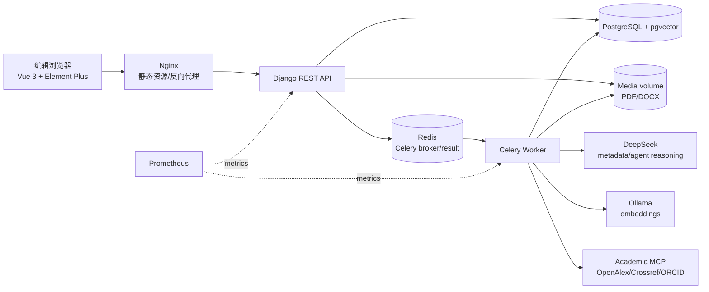
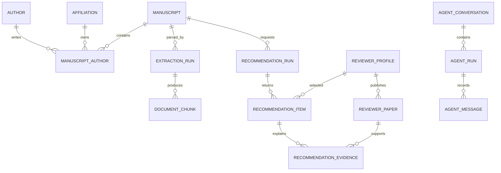
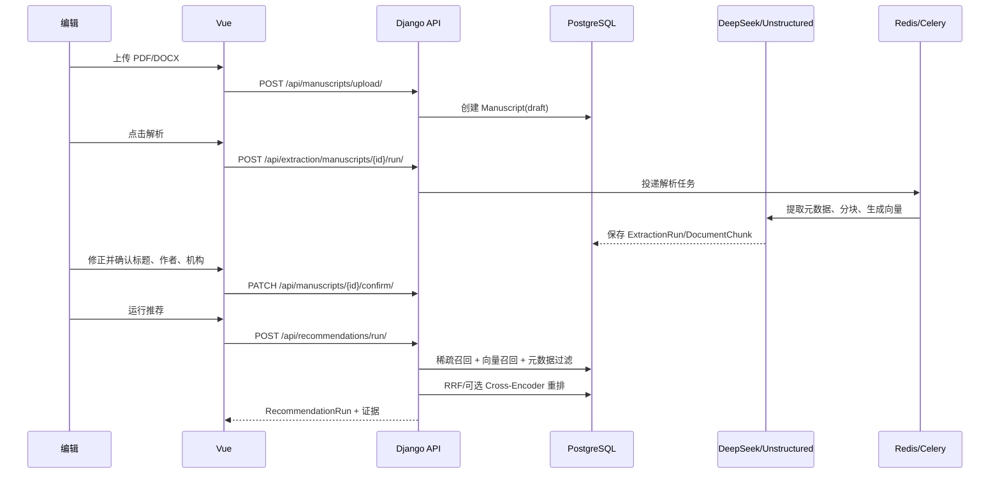

# RRS 系统设计

RRS（Reviewer Recommendation System）面向期刊编辑，完成“稿件导入 → 元数据确认 → 审稿人召回与排序 → 证据复核 → 邀请草稿”的闭环。系统将确定性业务逻辑、异步任务和大模型能力分开，保证推荐结果可追溯、长任务可恢复、外部动作必须人工确认。

## 1. 总体架构



运行时分为四类组件：

- **Web 层**：`frontend/` 负责工作台交互，`backend/config/` 提供 Django、健康检查和路由入口。
- **领域层**：`backend/apps/` 按稿件、解析、审稿人、推荐和 Agent 拆分，模型与序列化器保持在各领域内。
- **异步层**：Celery 执行文档解析、向量化和 Agent 长任务；Redis 只承担队列与结果传递，业务状态写入 PostgreSQL。
- **推理与检索层**：DeepSeek 负责结构化抽取和 Agent 推理，Ollama 负责向量，PostgreSQL 同时保存 BM25/元数据和 pgvector 索引。

## 2. 代码框架

```text
rrs/
├─ backend/
│  ├─ config/                 # Django、Celery、环境配置
│  └─ apps/
│     ├─ common/              # 健康检查、日志、指标、质量评测
│     ├─ manuscripts/         # 稿件、作者、机构与确认接口
│     ├─ extraction/          # Unstructured 解析、分块、向量检索
│     ├─ reviewers/           # 审稿人画像、论文、合作者关系
│     ├─ recommendations/     # 混合召回、重排、结果与证据
│     └─ agent/               # LangGraph、工具治理、审批和会话
├─ frontend/src/              # Vue 页面、编辑助手和 API 客户端
├─ infra/monitoring/          # Prometheus 配置与告警
├─ docs/                      # 运行手册、迭代记录、系统设计
└─ docker-compose*.yml        # 本地与服务器部署拓扑
```

Django 应用使用领域边界，而不是按技术类型建立一个巨型模块。跨领域调用通过服务函数或明确的 API 完成，数据库模型是持久化边界；这样可以在不改动前端契约的情况下替换推荐策略或模型供应商。

## 3. 核心数据模型



关键约束：

1. 核心实体使用 UUID；稿件作者通过中间表保存顺序、通讯作者和机构，避免把作者信息压成不可查询的 JSON。
2. `ExtractionRun`、`RecommendationRun` 和 `AgentRun` 都是不可替代的审计对象；每次重新解析或推荐都产生新运行记录。
3. `RecommendationItem` 保存最终分数和结构化 rationale，`RecommendationEvidence` 保存具体论文、召回路线和证据片段，支持结果解释和复核。
4. 向量字段同时提供 PostgreSQL pgvector 和 SQLite/JSON 兼容路径；生产环境使用 pgvector，测试环境可不依赖外部向量服务。

## 4. 业务流程

### 4.1 稿件与推荐



推荐排序把“能否作为候选人”和“候选人之间如何排序”分开：先过滤同机构、近年合作者等利益冲突，再融合关键词、BM25、向量、近期发表和工作量信号。外部学术数据只作为带来源标识的证据，不能覆盖本地编辑确认的数据。

### 4.2 编辑助手

Agent 使用单一 LangGraph 循环：加载上下文 → 调用 DeepSeek → 调用受限工具 → 写入检查点 → 返回答案。长任务通过 Celery 异步执行，`AgentRun` 保存状态、工具轨迹、停止原因和耗时；前端以轮询方式读取状态，因此浏览器刷新不会丢失任务。

工具按权限分为三类：

- **READ**：检索稿件证据、检查投稿完整性、推荐审稿人，可自动执行。
- **DRAFT**：生成解释或邀请邮件草稿，可自动执行，但结果标记为需要人工复核。
- **ACTION**：未来可能产生外部副作用的操作，先 `interrupt` 写入 `waiting_approval`，只有编辑明确同意才恢复执行。

当前系统不会自动发送邮件。审批接口的请求体为 `{ approved, approved_call_ids }`，前端和后端共享该契约。

## 5. 可靠性与安全边界

- Web 请求只负责校验、入库和投递；解析、向量化和 Agent 推理不占用 HTTP 请求生命周期。
- Agent 采用 admission、租约、Celery late-ack、硬/软超时和定时对账，避免重复执行或永久卡在 `processing`。
- 向量服务、重排模型和外部学术接口失败时保留 BM25/元数据路径，并在响应中返回降级状态，不能把降级结果伪装成完整检索。
- `AgentRun` 是业务审计记录，日志只记录关联 ID、状态和耗时；Prometheus 指标需要 token，生产 compose 不公开数据库、Redis 和后端端口。
- 目前 API 权限默认为 `AllowAny`，适合本地演示；正式部署前需补充登录、角色权限、TLS、备份恢复和媒体文件访问控制。

## 6. 启动与验证

本地容器启动：

```bash
cp .env.example .env
docker compose up -d --build
```

访问 `http://localhost`；API 健康检查为 `/health/live/` 和 `/health/ready/`。后端回归测试使用 SQLite：

```bash
python backend/manage.py check
python backend/manage.py test apps --verbosity 1
```

生产部署使用 `compose.server.yml`，监控叠加 `compose.monitoring.yml`。推荐结果质量不能由接口 200 或自动化测试代替，仍需独立人工标注集、Recall/MRR/nDCG 和 Agent 任务验收。

## 7. 后续扩展顺序

1. 接入认证与编辑/管理员角色，隔离稿件、候选人和审计数据。
2. 把解析和推荐统一为可观测任务状态，前端展示排队、降级和失败原因。
3. 建立带版本号的 reviewer 数据导入与 embedding 回填作业，支持增量更新和回滚。
4. 在人工标注集稳定后再校准重排权重、质量门禁和容量目标。
5. 只有在目标系统具备幂等键或 outbox 后，才增加真正的外部邀请发送动作。
